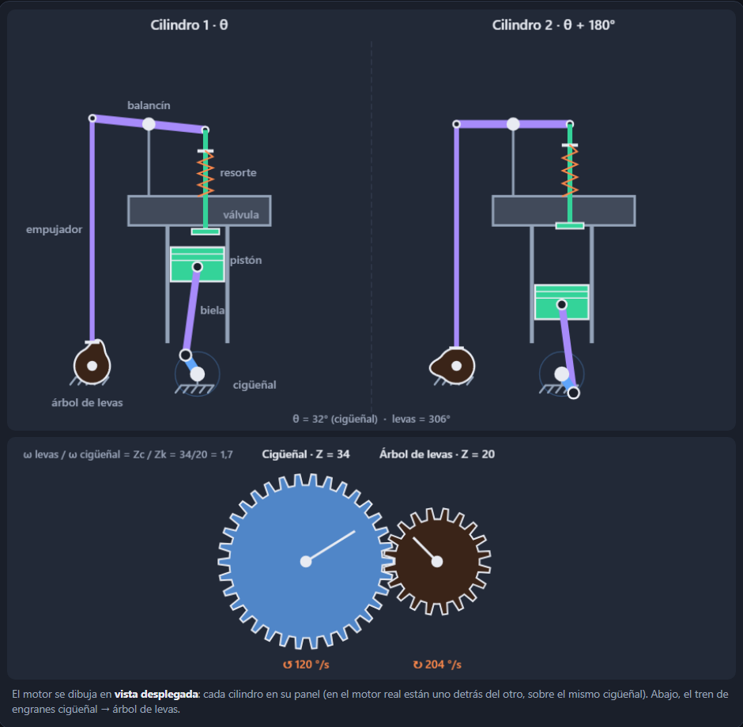
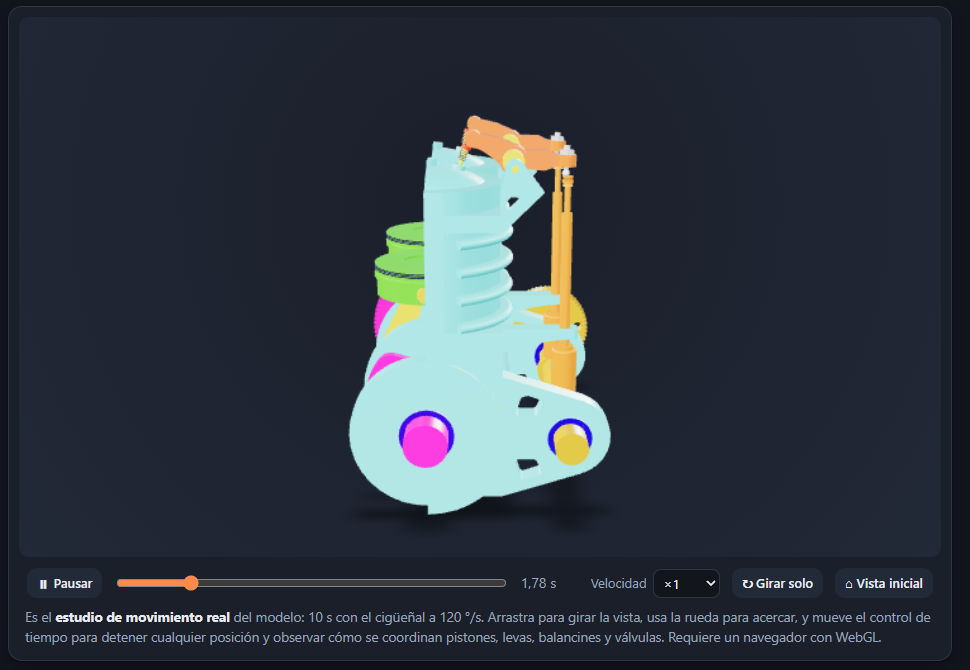

# ⚙️ Máquinas y Mecanismos — laboratorio interactivo

Un curso interactivo de **cinemática de mecanismos** que se aprende explorando: cada tema combina explicación, simulación que se mueve, ejemplo resuelto y una comprobación. Está hecho con HTML, CSS y JavaScript puros: **sin frameworks, sin build y sin instalar nada**.

Termina con un **caso de integración**: un motor bicilíndrico real analizado pieza por pieza, con su modelo 3D animado.

<p align="center">
  
  
</p>

## Contenido

**10 módulos · 41 lecciones.** Cada módulo sigue la secuencia *explorar → predecir → experimentar → explicar → comprobar*.

| # | Módulo | Lecciones |
|---|--------|:---:|
| 1 | Fundamentos de las máquinas y los mecanismos | 6 |
| 2 | Elementos mecánicos y sus movimientos | 5 |
| 3 | Diagramas cinemáticos | 3 |
| 4 | Movilidad y grados de libertad (ecuación de Grübler) | 4 |
| 5 | Inversión cinemática y mecanismo de cuatro barras (Grashof) | 4 |
| 6 | Manivela-corredera y mecanismos de propósito especial | 4 |
| 7 | Herramientas para estudiar mecanismos | 2 |
| 8 | Laboratorio final de diseño y evaluación | 2 |
| 9 | Clasificación de mecanismos por su función | 5 |
| 10 | **El motor bicilíndrico: una máquina y sus mecanismos** | 6 |

### Módulo 10 · el motor como caso de estudio

El motor completo es una **máquina térmica**; lo que se estudia aquí es la parte mecánica que contiene, es decir, sus **mecanismos** (análisis cinemático, sin combustión ni fuerzas).

Cada subsistema del motor se analiza con la **ficha tipológica** del capítulo 1 (elementos y forma · número · uniones · movimientos · leyes · función):

| Subsistema | Entrada → salida | Tipo |
|---|---|---|
| ① Pistón–biela–cigüeñal | circular → lineal | transforma |
| ② Engranes | circular → circular | transmite |
| ③ Leva–empujador | circular → lineal con paradas | transforma |
| ④ Balancín | lineal → lineal (invierte el sentido) | transmite (palanca) |
| ⑤ Válvula y resorte | lineal → lineal | seguidor final; el resorte acumula energía |

Incluye el conteo numerado de eslabones y uniones (M = 3(13 − 1) − 2·14 − 7 = 1), un **simulador** con los dos cilindros, el tren de engranes y gráficas de posición, velocidad y aceleración, el **modelo 3D animado** y las 46 gráficas del estudio de movimiento con su interpretación.

## Qué tiene

- 🎛 **Simulaciones interactivas** en canvas y SVG: pares cinemáticos, engranes, levas, cuatro barras, manivela-corredera, mecanismos de propósito especial, entre otras.
- 🧮 **Calculadoras y widgets**: movilidad de Grübler, criterio de Grashof, análisis de posición, relación de transmisión, palancas.
- 🧊 **Visor 3D** del motor con su estudio de movimiento (control de tiempo, velocidad y vista).
- ✅ **Comprobación al final de cada lección**, con retroalimentación razonada, y ejercicios con solución que se muestra después de intentar.
- 💾 **Progreso guardado en el navegador** (`localStorage`); no hay servidor ni cuentas.
- 🌗 Tema claro/oscuro automático, navegación por lecciones y diseño adaptable a pantallas pequeñas.

## Cómo usarlo

No requiere instalación. Elige una opción:

```bash
# 1) Abrir directamente
#    doble clic en index.html

# 2) O servirlo en local (recomendado)
python -m http.server 8000
# y abrir http://localhost:8000
```

Todo funciona abriendo `index.html` desde el disco, incluido el visor 3D (el modelo viaja incrustado en `motor/motor-glb.js`). El visor necesita un navegador con **WebGL**.

## Estructura

```
index.html            contenido de las 41 lecciones
style.css, visual.css estilos
app.js, extra*.js     simulaciones (canvas) y utilidades
nav.js                navegación, progreso y comprobaciones
visual.js             escenas SVG, videos y glosario
tipos.js, pares.js    widgets de los módulos 1, 2 y 9
repaso.js             repaso y autoevaluación
motor.js              simulador cinemático del motor
motor3d.js            visor 3D (carga bajo demanda)
layout.js             maquetación: columnas desiguales y ampliar imágenes
img/                  fotos e ilustraciones
motor/
  video/              video del estudio de movimiento
  img/                las 46 gráficas del estudio de movimiento
  vendor/             model-viewer (visor 3D)
  motor-glb.js        el modelo 3D en base64 (generado)
tools/make_glb_js.py  prepara el modelo 3D a partir de un .glb
docs/                 imágenes de este README
```

## El modelo 3D del motor

El visor del módulo 10 muestra la animación del estudio de movimiento del ensamble. El modelo de CAD original (ensamble y piezas de SolidWorks) **no forma parte de este repositorio**: se conserva aparte.

Para actualizar la animación, exporta desde SolidWorks en *Guardar como → GLTF/GLB* con **Exportar estudios de movimiento** marcado y ejecuta:

```bash
python tools/make_glb_js.py ruta/al/Motor.glb
```

El script **repara** el `.glb` si SolidWorks lo exportó con los desplazamientos de la animación mal repartidos (los visores estrictos lo rechazan con `Invalid typed array length`) y regenera `motor/motor-glb.js`.

> ⚠️ **Sobre el modelo estudiado.** En el estudio de movimiento el cigüeñal gira a 120 °/s y el árbol de levas a ≈ 206 °/s (razón ≈ 1,72). Un motor de cuatro tiempos de referencia necesita 0,5. El modelo sirve para estudiar **cinemática**, no está sincronizado como un motor real; la lección 10.1 lo explica desde el principio.

## Tecnología

HTML + CSS + JavaScript sin dependencias de compilación. El único componente de terceros es [`<model-viewer>`](https://modelviewer.dev/) (Apache-2.0), incluido en `motor/vendor/` para que todo funcione sin conexión.

## Estado

Este es un material en construcción. Lo que viene:

- [ ] Reescribir 1.2 y 1.5 para introducir los fundamentos con más calma y paso a paso.
- [ ] Dividir 5.3 (cuatro barras) en tres lecciones progresivas.
- [ ] Ampliar las descripciones de los mecanismos de la lección 6.3.
- [ ] Esquema del gato de tijera con sus 9 eslabones numerados (1.6).
- [ ] Tres niveles por lección: comprender · analizar · aplicar.
- [ ] Validar las lecciones con estudiantes sin formación previa.

## Licencia

Sin licencia definida por ahora: todos los derechos reservados hasta que se elija una. El visor `model-viewer` conserva su licencia Apache-2.0.
